  
  
  
  
  

Hey, I'm Subhash. I'm a full-stack software engineer with 3+ years building backend services and web applications across finance and higher education. I'm currently a Systems Developer at Clemson University, and I'm open to software engineering opportunities. Outside of work I make games.

### Games

<table>
<tr>
<td width="88" valign="top"></td>
<td valign="top">

**[Infinite Labyrinth](https://lasterminator.github.io/infinite-labyrinth/)**&ensp;`React Native` `Expo`
 Find the way out and beat the clock. A swipe-to-run maze game with a 60-level Journey, a Daily Maze and an Endless mode.
 [App Store](https://apps.apple.com/us/app/infinite-labyrinth/id6824725791) · [Google Play](https://play.google.com/store/apps/details?id=com.subhash8111999.infinitelabyrinth.game)

</td>
</tr>
<tr>
<td width="88" valign="top"></td>
<td valign="top">

**[Lantern City](https://lasterminator.github.io/lantern-city/)**&ensp;`React Native` `Expo`
 A rhythm game about tapping right on the beat. Every catch uncovers a piece of a hidden picture, across twenty-five islands.
 [App Store](https://apps.apple.com/us/app/lantern-city-rhythm-game/id6824568843) · [Google Play](https://play.google.com/store/apps/details?id=com.trinathpittala.lanterncity)

</td>
</tr>
</table>

### Projects

<table>
<tr>
<td width="50%" valign="top">

**[Org License Manager](https://github.com/Lasterminator/OrgLicenseManager)**&ensp;`.NET 8` `PostgreSQL`
 Multi-tenant SaaS API with JWT authentication and role-based access control for organizations, invitations and software licenses, with automatic renewal in background services.

</td>
<td width="50%" valign="top">

**[Agentic RAG](https://github.com/Lasterminator/Agentic-Rag-faculty-polacy)**&ensp;`Python` `LangChain`
 Retrieval-augmented generation for querying faculty policies, using LLM agents with document retrieval to give accurate, context-aware answers.

</td>
</tr>
<tr>
<td width="50%" valign="top">

**[CUDA AES-128](https://github.com/Lasterminator/CUDA-AES)**&ensp;`CUDA` `C++`
 GPU-parallel AES-128 encryption and decryption with multi-stream processing, pinned host memory, and shared and constant memory optimizations. Handles 1 GB files.

</td>
<td width="50%" valign="top">

**[Hearing Loss Prediction from MRI](https://github.com/Lasterminator/Hearing-Loss-Prediction-from-MRI)**&ensp;`Python` `PyTorch`
 ML pipeline using autoencoders and CNNs to predict hearing loss thresholds from 3D brain MRI. Written up as a [paper](https://arxiv.org/abs/2405.00142).

</td>
</tr>
<tr>
<td width="50%" valign="top">

**[Messenger](https://github.com/Lasterminator/messengerApp)**&ensp;`React Native` `Firebase`
 Mobile messenger with real-time chat, group messaging, image sharing and push notifications on iOS and Android.

</td>
<td width="50%" valign="top">

**[ImageCloud](https://github.com/Lasterminator/ImageCloud)**&ensp;`AWS` `Node.js` `Python`
 Multi-tier image recognition service on AWS: uploads go to S3 and queue in SQS, and an app tier on EC2 works through the queue.

</td>
</tr>
<tr>
<td width="50%" valign="top">

**[Mood Journal](https://github.com/Lasterminator/Mood_Journal)**&ensp;`Swift` `SwiftUI`
 iOS app for tracking mood and activities, with interactive statistics and Face ID.

</td>
<td width="50%" valign="top">

**[Festive Fusion](https://github.com/Lasterminator/Festive-Fusion)**&ensp;`Python` `Pygame`
 Multi-level holiday-themed game built around the Memento, Singleton and Factory design patterns.

</td>
</tr>
</table>

### Where I've been

| When | Where | What |
|------|-------|------|
| **May 2024 - Present** | **[Clemson University](https://www.clemson.edu/)** | Systems Developer -- Led the design and build of a production observability platform (Python/FastAPI, Next.js/React) that gives engineers one live view of 450+ networked devices across 54 rooms. Built an AI troubleshooting engine that cut fault diagnosis time by 75%, consolidated 15,000+ data files into one searchable database, and backed releases with 380+ automated tests and one-command deploys. |
| **July 2021 - December 2022** | **[RBL Bank](https://www.rblbank.com/)** | Software Engineer -- Built a transaction reconciliation portal (ASP.NET, SQL Server) that automates error resolution for 1M+ daily payments, saving 4 hours a day. Cut transaction failures by 78% with a dispute resolution system on .NET Core, automated partner onboarding for 1,000+ vendors, and reduced server load by 30%. |
| **July 2020 - April 2021** | **[Glocol Networks](https://www.glocol.net/)** | SWE Intern -- Migrated backend workloads to AWS Lambda, cutting compute costs by 40%. Built DynamoDB pipelines for 35+ IoT devices and a Bluetooth transit tracker that produced 96%-accurate passenger counts. |
| **August 2019 - June 2020** | **[BITS Pilani](https://www.bits-pilani.ac.in/)** | Research Assistant -- Built a Node.js + SQL web app for managing 5,000+ departmental financial records. Developed REST APIs that reduced manual spreadsheet work by 25%. |

| Degree | School | Year |
|--------|:------:|:----:|
| M.S. Computer Science | Clemson University | January 2023 - December 2024 |
| B.E. Computer Science | Birla Institute of Technology and Science Pilani, Hyderabad | August 2017 - May 2021 |

### Research

- [A Novel Approach to Guard from Adversarial Attacks using Stable Diffusion](https://arxiv.org/abs/2405.01838) · arXiv, May 2024 · [code](https://github.com/Lasterminator/CPSC-8570-Network-Technologies-Security)
- [Utilizing Machine Learning and 3D Neuroimaging to Predict Hearing Loss: A Comparative Analysis](https://arxiv.org/abs/2405.00142) · arXiv, April 2024 · [code](https://github.com/Lasterminator/Hearing-Loss-Prediction-from-MRI)
- [Unveiling Patterns in European Airbnb Prices: A Comprehensive Analytical Study Using ML Techniques](https://www.irjet.net/archives/V10/i12/IRJET-V10I12153.pdf) · IRJET, December 2023 · [code](https://github.com/Lasterminator/AirBnB-Price-Determinents)

### What I work with

**Languages**&ensp;`Python` `C#` `TypeScript` `JavaScript` `SQL` `Java` `C++`

**Frameworks**&ensp;`.NET Core` `Entity Framework` `FastAPI` `Node.js` `React` `Next.js` `React Native`

**Cloud & tools**&ensp;`AWS Lambda` `EC2` `S3` `DynamoDB` `Docker` `Kafka` `GitHub Actions`

**Databases**&ensp;`PostgreSQL` `SQL Server` `MySQL` `MongoDB` `SQLite`

**Certified**&ensp;[AWS Solutions Architect, Associate](https://cp.certmetrics.com/amazon/en/public/verify/credential/22c4e7f0f677493f8d08e49eb2c58e6f)

### Get in touch

- Email: [subhash8111999@gmail.com](mailto:subhash8111999@gmail.com)
- LinkedIn: [linkedin.com/in/trinathpittala](https://linkedin.com/in/trinathpittala/)
- Portfolio: [trinathpittala.com](https://trinathpittala.com/)
