<!-- Generated by build.mjs from content.mjs. Edit content.mjs, then run: node build.mjs -->

  
  
  
  
  

Hey, I'm Subhash. I'm a full-stack software engineer with 3+ years building backend services and web applications across finance and higher education. I'm currently a Systems Developer at Clemson University, and I'm open to software engineering opportunities. Outside of work I make games.

### Games

  <a href="https://lasterminator.github.io/infinite-labyrinth/">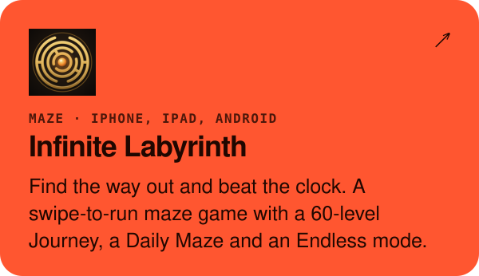</a>
  <a href="https://lasterminator.github.io/lantern-city/">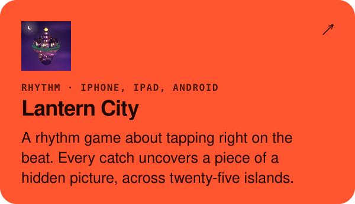</a>
  
  
  
  

### Projects

  <a href="https://github.com/Lasterminator/OrgLicenseManager">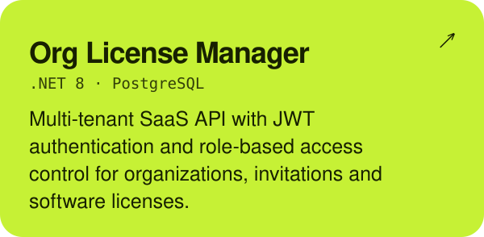</a>
  <a href="https://github.com/Lasterminator/Agentic-Rag-faculty-polacy">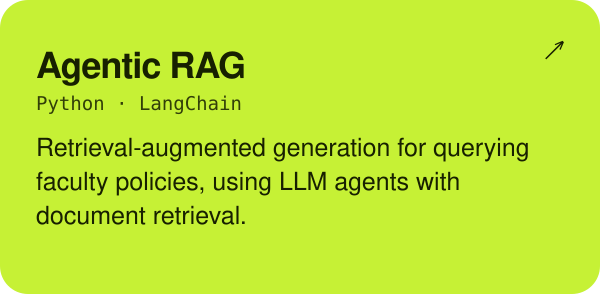</a>
  <a href="https://github.com/Lasterminator/CUDA-AES">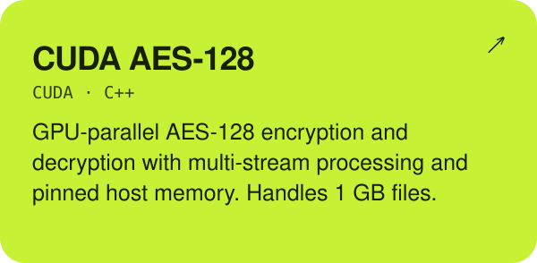</a>
  <a href="https://github.com/Lasterminator/Hearing-Loss-Prediction-from-MRI">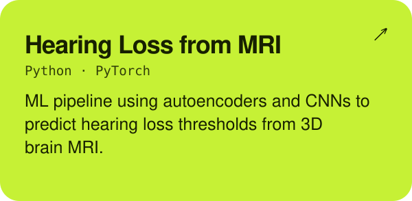</a>
  <a href="https://github.com/Lasterminator/messengerApp">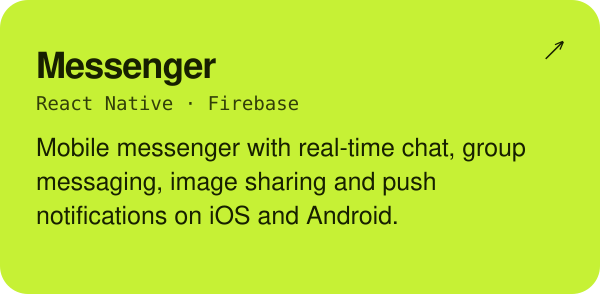</a>
  <a href="https://github.com/Lasterminator/ImageCloud">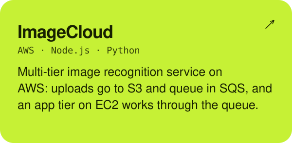</a>
  <a href="https://github.com/Lasterminator/Mood_Journal">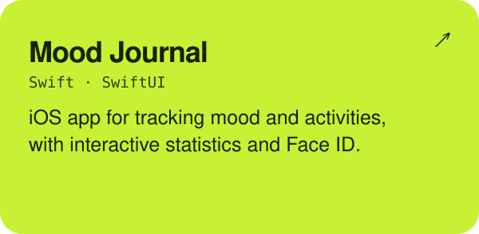</a>
  <a href="https://github.com/Lasterminator/Festive-Fusion">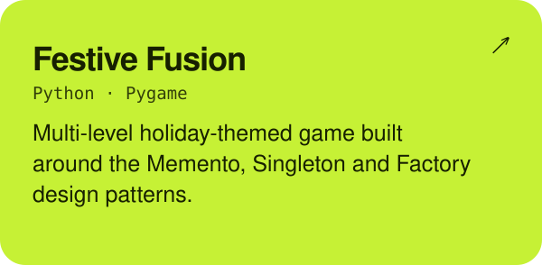</a>

### Where I've been

  <a href="https://www.clemson.edu/">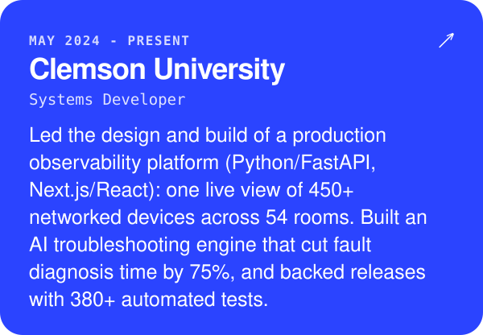</a>
  <a href="https://www.rblbank.com/">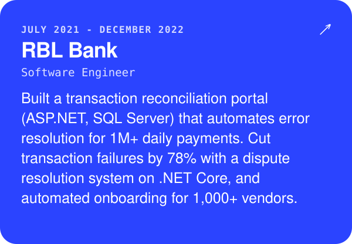</a>
  <a href="https://www.glocol.net/">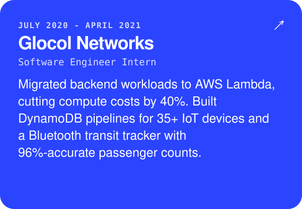</a>
  <a href="https://www.bits-pilani.ac.in/">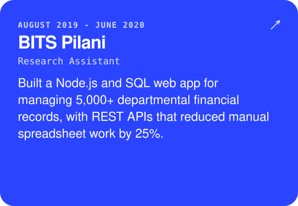</a>

### Education

  <a href="https://www.clemson.edu/">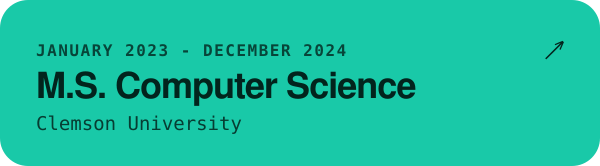</a>
  <a href="https://www.bits-pilani.ac.in/">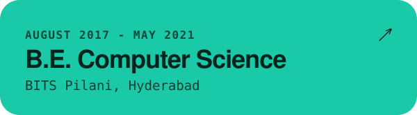</a>

### Research

  <a href="https://arxiv.org/abs/2405.01838">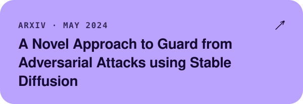</a>
  <a href="https://arxiv.org/abs/2405.00142">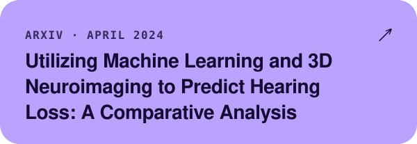</a>
  <a href="https://www.irjet.net/archives/V10/i12/IRJET-V10I12153.pdf">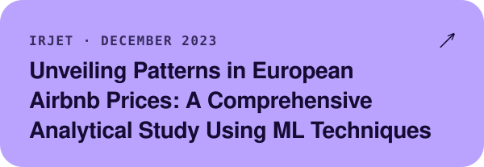</a>

### What I work with

  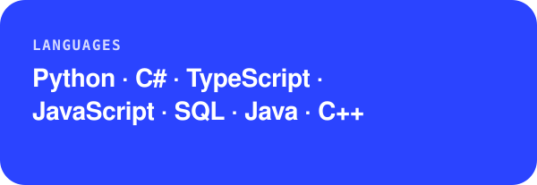
  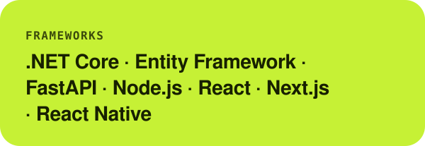
  
  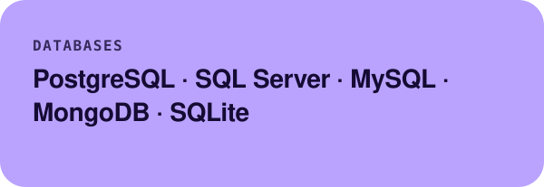
  

### Get in touch

  
  
  

